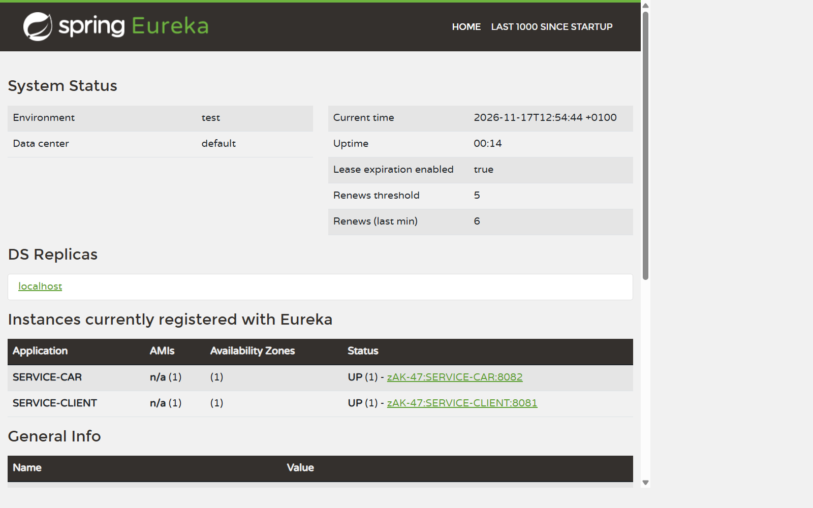
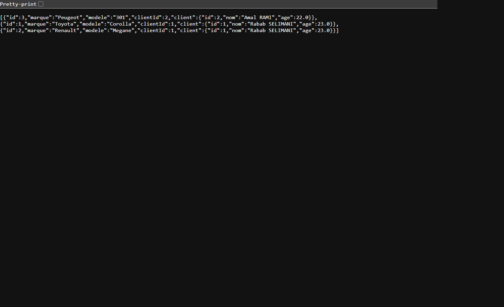

# J2E-TP21 — Architecture microservices avec WebClient

TP 21 du cours *Architecture Microservices* — communication inter-services **réactive** avec `WebClient` et `@LoadBalanced`, sans Gateway.



## Stack

`Java 17` · `Spring Boot 3.3` · `Spring Cloud 2023.0.3` · `WebFlux / WebClient` · `Eureka` · `Spring Cloud LoadBalancer` · `MySQL`

## Modules

```
J2E-TP21-WebClient/
├── eureka-server/    8761  registre
├── service-client/   8081  SERVICE-CLIENT : /api/clients
└── service-car/      8082  SERVICE-CAR : WebClient + @LoadBalanced
```

## Lancer

```sql
CREATE DATABASE clientservicedb;
CREATE DATABASE carservicedb;
```

```bash
mvn -pl eureka-server  spring-boot:run
mvn -pl service-client spring-boot:run
mvn -pl service-car    spring-boot:run

mvn test
```

## Configuration WebClient

```java
@Bean
@LoadBalanced
public WebClient.Builder webClientBuilder() {
    return WebClient.builder();
}
```

`@LoadBalanced` est **indispensable** : sans lui, Spring ne sait pas résoudre
`SERVICE-CLIENT` et lève `No instances available for SERVICE-CLIENT`.
La dépendance `spring-cloud-starter-loadbalancer` doit également être présente.

```java
public Mono<Client> monoClientById(Long id) {
    return builder.build()
            .get()
            .uri("http://SERVICE-CLIENT/api/clients/" + id)
            .retrieve()
            .bodyToMono(Client.class);
}
```

## Endpoints

| URL | Description |
|---|---|
| `GET /api/clients` | liste des clients |
| `GET /api/clients/{id}` | un client |
| `POST /api/clients` | création |
| `GET /api/test/client/{id}` | validation du WebClient (proxy direct) |
| `GET /api/cars` | voitures + propriétaire via WebClient |
| `GET /api/cars/{id}` | une voiture + propriétaire |
| `GET /api/cars/client/{id}` | voitures d'un client |



```json
[{"id":1,"marque":"Toyota","modele":"Corolla","clientId":1,
  "client":{"id":1,"nom":"Rabab SELIMANI","age":23.0}}]
```

## `block()` et threads réactifs

service-car tourne sur **WebFlux/Netty**. Appeler `block()` dans un handler lève :

```
java.lang.IllegalStateException: block()/blockFirst()/blockLast() are blocking,
which is not supported in thread reactor-http-nio-x
```

Deux variantes sont donc exposées dans `ClientApi` :

- `monoClientById(id)` → `Mono<Client>`, utilisée par les contrôleurs (100 % réactif)
- `findClientById(id)` → `block()`, conservée pour un usage hors thread Netty (tests, batch)

Les contrôleurs composent le `Mono` et enrichissent chaque voiture de façon asynchrone,
avec `onErrorResume` pour ne pas casser la liste si SERVICE-CLIENT est indisponible.

## Tests

**9/9** :

| Module | Tests |
|---|---|
| eureka-server | 1 (contexte) |
| service-client | 3 (CRUD `/api/clients`) |
| service-car | 5 (liste sans client-service, 404, filtre par client, bean WebClient, échec explicite sans discovery) |

`service-car` étant réactif, les tests HTTP utilisent `WebTestClient` et non `MockMvc`.

## Pièges rencontrés et corrigés

1. **`block()` interdit sur thread Netty** — les contrôleurs renvoient désormais `Mono`/`Flux`.
2. **404 perdu avec `Mono.justOrEmpty`** — un `Mono` vide renvoie `200` avec corps vide ;
   corrigé par `switchIfEmpty(Mono.error(new ResponseStatusException(NOT_FOUND)))`.

Auteur : [zAK4-7](https://github.com/zAK4-7)
